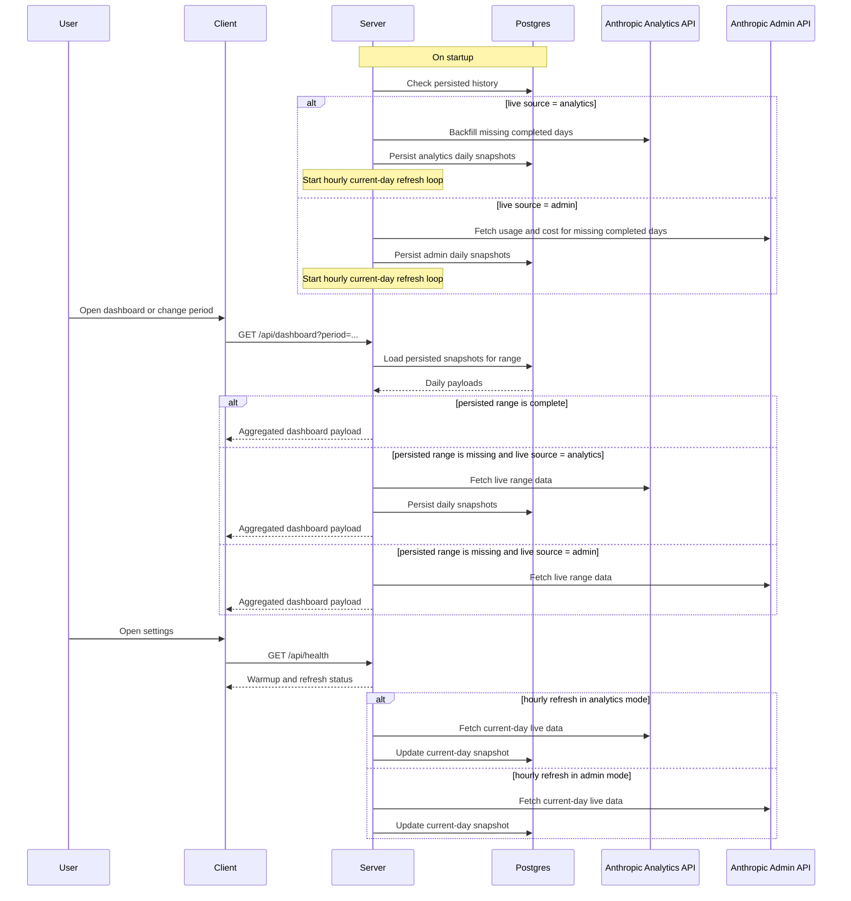
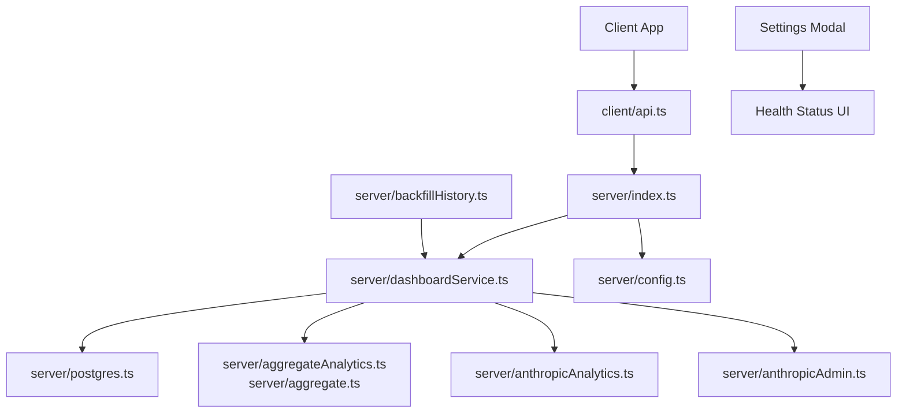

# System Architecture

This document shows the major parts of the dashboard system and how they interact.

## High-level architecture

```mermaid
flowchart LR
    U[User in Browser]
    C[React Client<br/>Vite app]
    S[Express Server<br/>dashboardService]
    DB[(Postgres<br/>dashboard_snapshots)]
    A1[Anthropic Analytics API]
    A2[Anthropic Admin API]
    W[Startup Warmup<br/>Last 180 completed days]
    H[Hourly Current-Day Refresh]
    DD[/api/dashboard]
    HE[/api/health]

    U --> C
    C -->|GET dashboard data| DD
    C -->|GET sync status| HE

    DD --> S
    HE --> S

    S -->|read persisted snapshots| DB
    S -->|write daily snapshots| DB

    W --> S
    H --> S

    S -->|live source = analytics| A1
    S -->|live source = admin| A2
```

## Request and refresh flow



## Component view



## Responsibility split

- The client only talks to the backend and never calls Anthropic directly.
- The server owns orchestration: persisted reads, warmup, hourly refresh, aggregation, and health reporting.
- Postgres is the persisted store for historical daily snapshots and reused range reads.
- Anthropic APIs are upstream sources used only by the server.
- Current-day live refresh and completed-day historical backfill are separate paths.