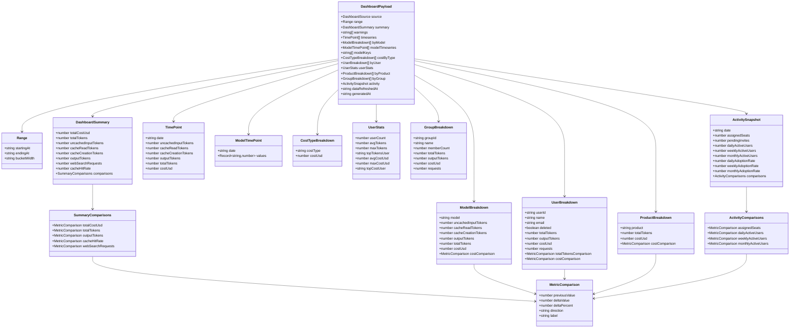
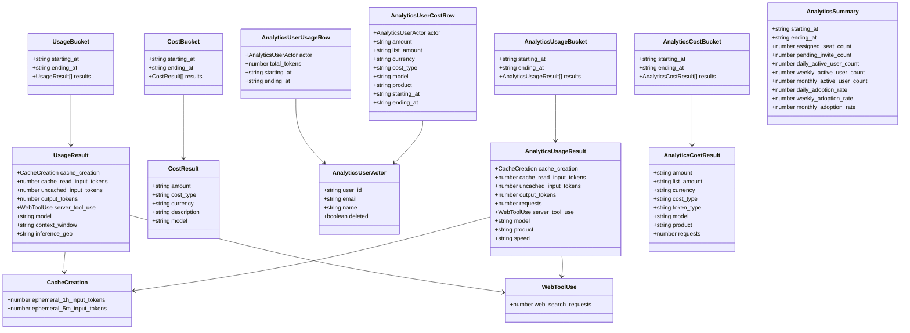
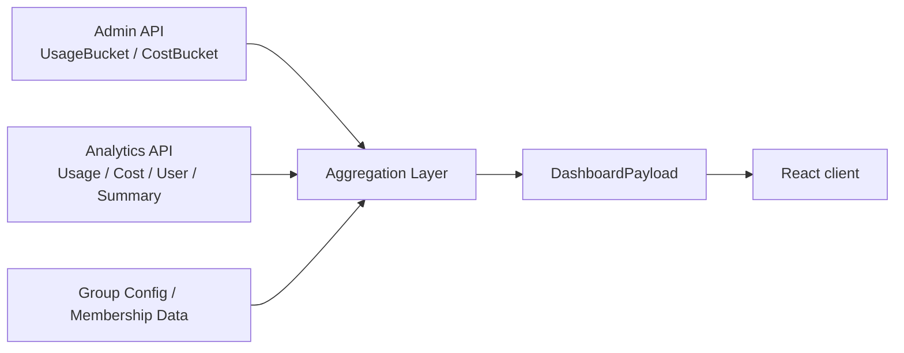

# Data Schemas

This document captures the main data structures used by the dashboard pipeline.

- Source-of-truth types: [server/src/types.ts](../server/src/types.ts)
- Frontend mirror types: [client/src/types.ts](../client/src/types.ts)

## Aggregated dashboard payload

## Source API schemas

## Data flow

